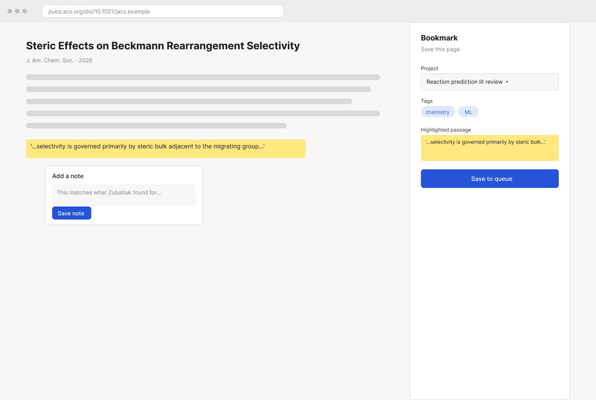
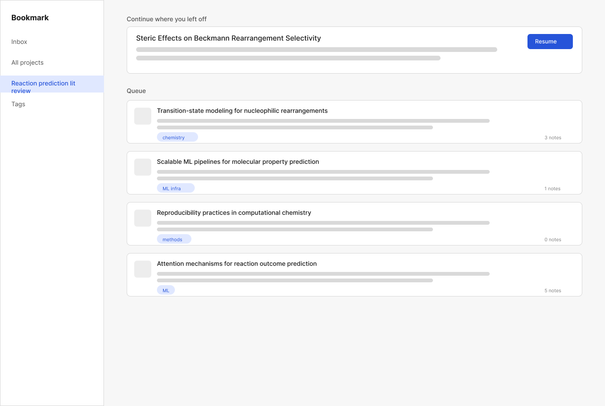
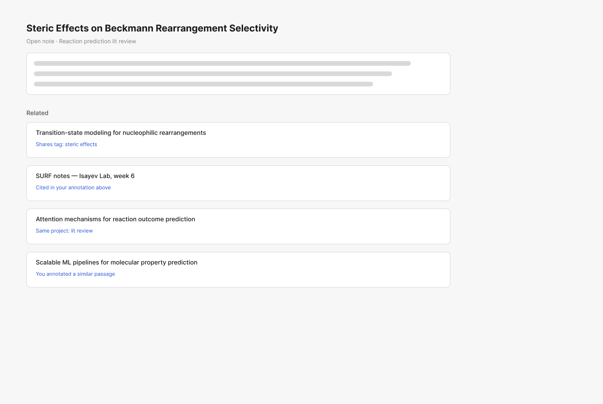
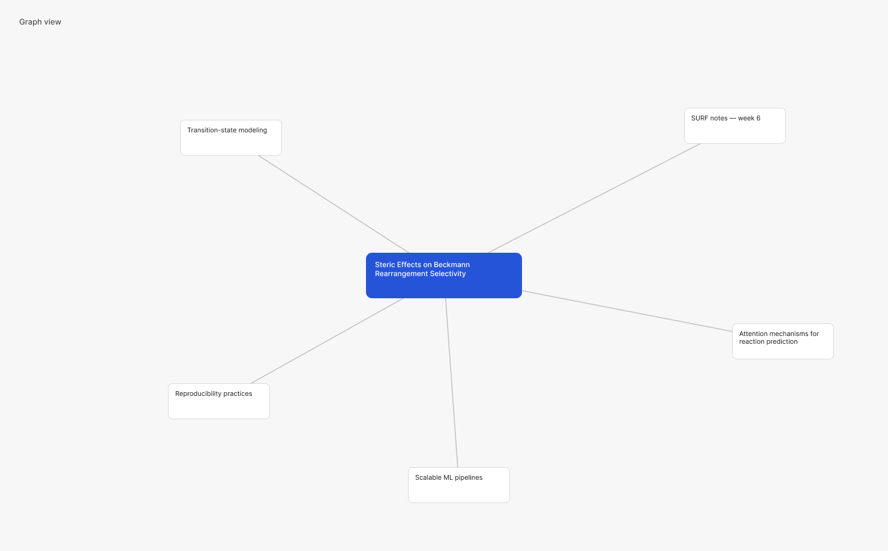

# Bookmark

A web-based workspace for keeping track of your ideas and research. It combines a browser extension for saving and annotating with a web app for your working queue, a connections graph, and an AI assistant that helps reorganize your thinking.



## Status
In the design phase. See **[docs/FEATURES.md](docs/FEATURES.md)** for every feature, its spec, its Figma frame and its status, and **[docs/ROADMAP.md](docs/ROADMAP.md)** for what's next.

| Save & annotate | Working queue | Connections (block) | Connections (graph) |
|---|---|---|---|
|  |  |  |  |

## Design
Wireframes: [Figma — Bookmark Wireframes](https://www.figma.com/design/hzWrF1m4Lnz5pIspJj8gKa/Bookmark-%E2%80%94-Wireframes)

## Repo layout
```
docs/
  FEATURES.md      feature index (spec ↔ Figma ↔ status ↔ code)
  ROADMAP.md       next steps checklist
  features/        one spec per feature (+ _TEMPLATE.md)
  wireframes/      PNG snapshots of the Figma frames
CLAUDE.md          instructions for Claude Code working in this repo
```
